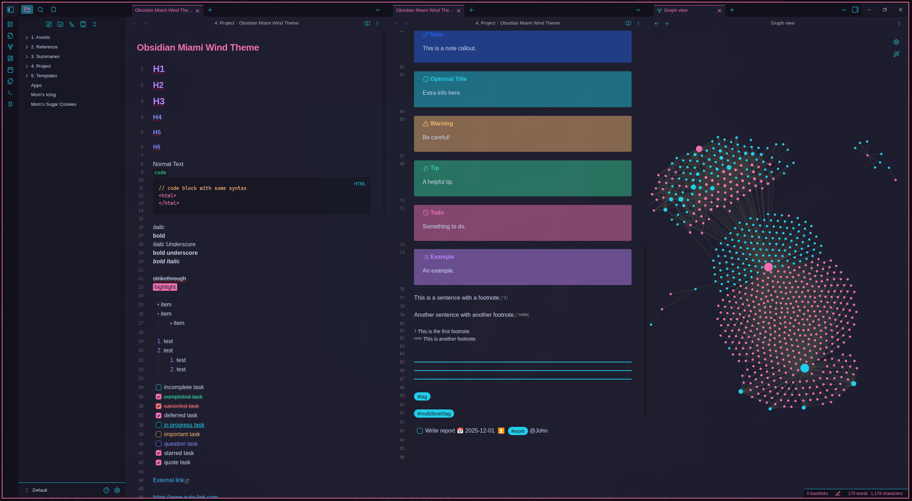
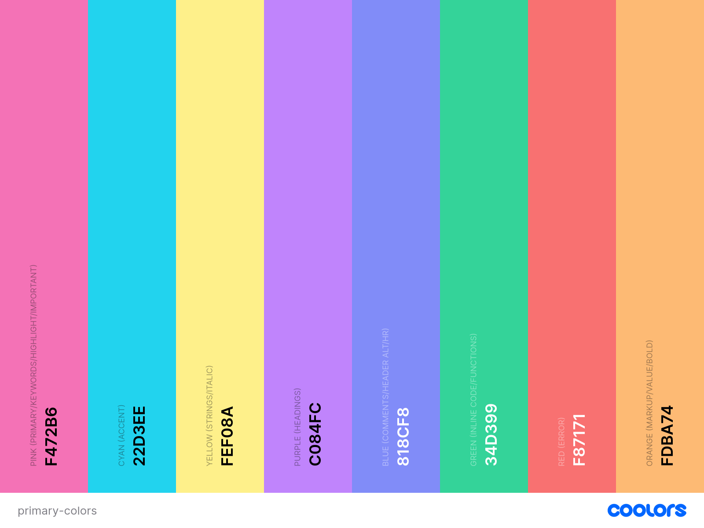
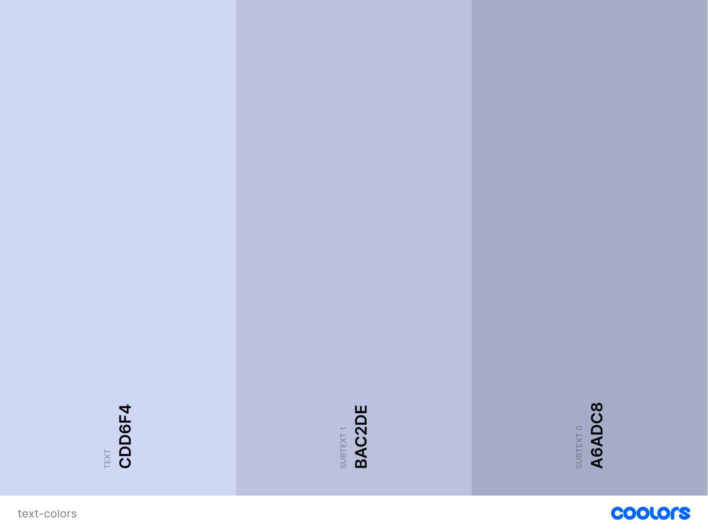
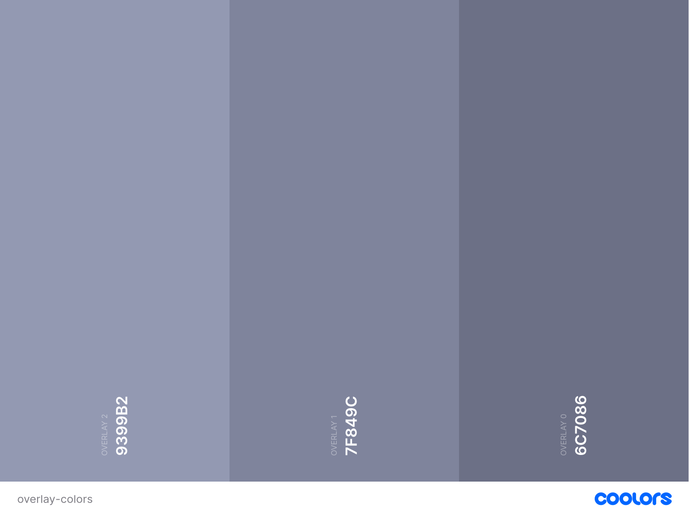
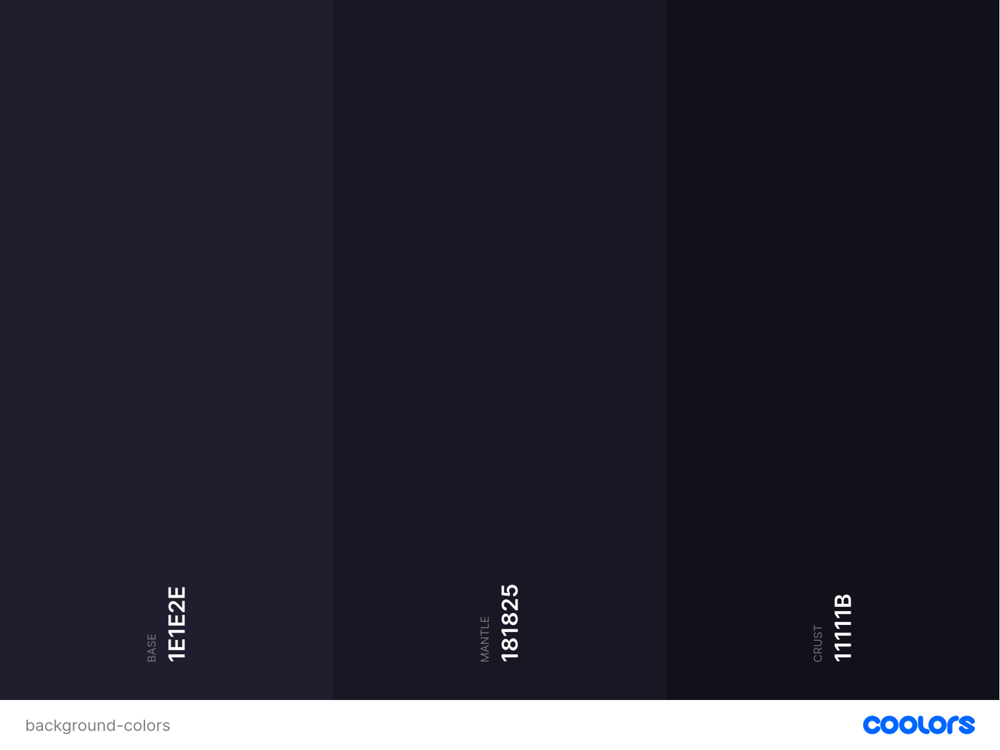

# Miami Wind Obsidian Theme
An Obsidian theme based on Miami Wind color scheme which is a blend of colors from [Tailwind CSS](https://tailwindcss.com/docs/colors) and Greyscale colors from [Catppuccin Mocha](https://catppuccin.com/) with inspiration from the theme [Miami Nights](https://github.com/monkeytypegame/monkeytype/blob/master/frontend/static/themes/miami_nights.css) for [Monkeytype](https://www.monkeytype.com). Color Swatches built using [Coolors](https://coolors.co/)

## Installation

### From Obsidian

1. Open **Settings**.
2. Under **Appearance → Themes**, select **Manage**.
3. Search for **Miami Wind**.
4. Select **Miami Wind**.
5. Select **Install and use**.

### Manual installation

1. Download `manifest.json` and `theme.css` from the [latest release](https://github.com/hanakin/miami-wind-obsidian-theme/releases/latest).
2. Create the folder `<vault>/.obsidian/themes/Miami Wind/`.
3. Copy both files into that folder.
4. Open **Settings → Appearance** in Obsidian.
5. Select **Miami Wind** under **Themes**.

### Customization

This theme has no Style Settings options. Override colors with a [CSS snippet](https://help.obsidian.md/snippets).

## Preview

## Color Palette

## Base Colors
[Primary Colors](https://coolors.co/f472b6-22d3ee-fef08a-c084fc-818cf8-34d399-f87171-fdba74)

## Additional Colors
[Bright Colors](https://coolors.co/palette/ec4899-38bdf8-fde047-a78bfa-2563eb-4ade80-f43f5e-fb923c)

## Greyscale

[Text Colors](https://coolors.co/cdd6f4-bac2de-a6adc8)

[Overlay Colors](https://coolors.co/9399b2-7f849c-6c7086)

[Surface Colors](https://coolors.co/585b70-45475a-313244)

[Background Colors](https://coolors.co/1e1e2e-181825-11111b)

