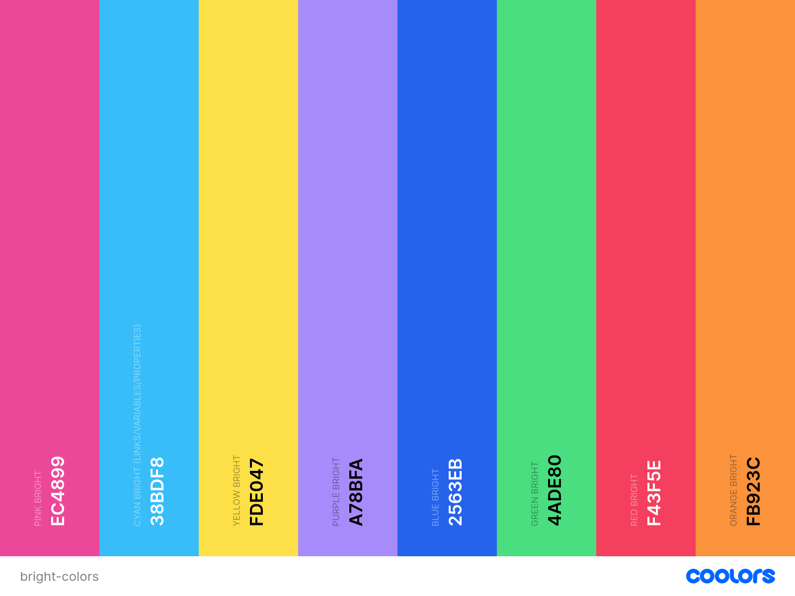
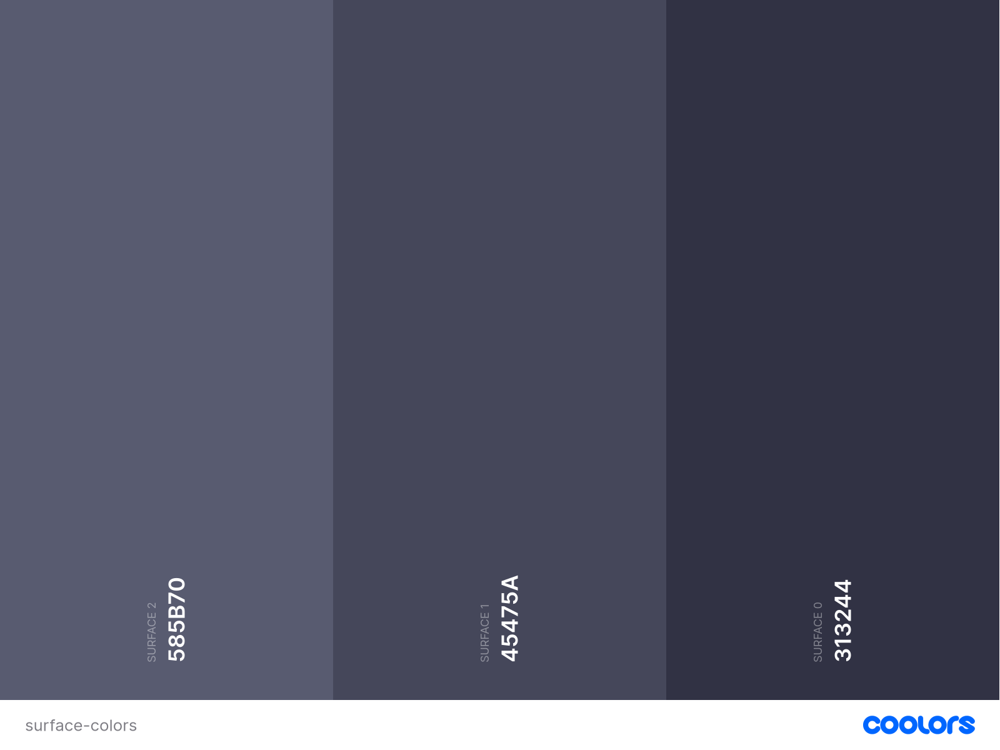

# Miami Wind Obsidian Theme
An Obsidian theme based on Miami Wind color scheme which is a blend of colors from [Tailwind CSS](https://tailwindcss.com/docs/colors) and Greyscale colors from [Catppuccin Mocha](https://catppuccin.com/) with inspiration from the theme [Miami Nights](https://github.com/monkeytypegame/monkeytype/blob/master/frontend/static/themes/miami_nights.css) for [Monkeytype](https://www.monkeytype.com). Color Swatches built using [Coolors](https://coolors.co/)

## Preview


## Color Palette

## Base Colors
[Primary Colors](https://coolors.co/f472b6-22d3ee-fef08a-c084fc-818cf8-34d399-f87171-fdba74)


## Additional Colors
[Bright Colors](https://coolors.co/palette/ec4899-38bdf8-fde047-a78bfa-2563eb-4ade80-f43f5e-fb923c)



## Greyscale

[Text Colors](https://coolors.co/cdd6f4-bac2de-a6adc8)


[Overlay Colors](https://coolors.co/9399b2-7f849c-6c7086)


[Surface Colors](https://coolors.co/585b70-45475a-313244)



[Background Colors](https://coolors.co/1e1e2e-181825-11111b)


## Releasing

1. Set `version` in `manifest.json` to the new version, `X.Y.Z`, without a `v` prefix.
2. Commit the change on a PR branch:
   ```sh
   git switch -c release-X.Y.Z
   git add manifest.json
   git commit -m "Release X.Y.Z"
   git push -u origin HEAD
   ```
3. Open a PR against `main`.
4. Merge the PR.
5. Update your local `main`:
   ```sh
   git switch main
   git pull --ff-only origin main
   ```
6. Create and push the matching tag:
   ```sh
   git tag -a X.Y.Z -m "X.Y.Z"
   git push origin X.Y.Z
   ```
7. Open the **Actions** tab to check the run.
8. Open **Releases** to check the published release and its `manifest.json` and `theme.css` assets.
